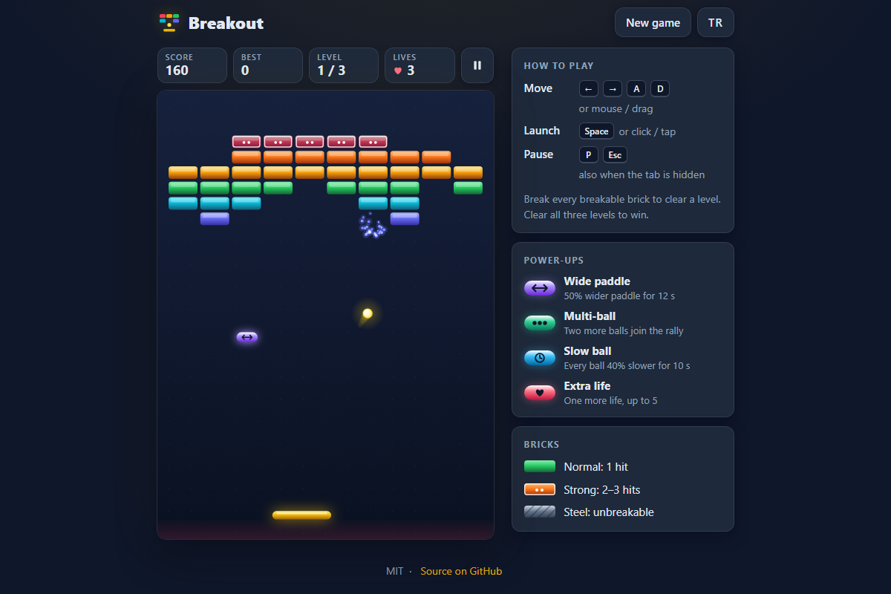

# Breakout - a polished brick-breaking arcade game for your browser

[](#tests)
[](LICENSE)

**▶ Play now: https://celaldrg.github.io/breakout/**



## Features

- Three hand-made levels with normal (1 hit), strong (2–3 hits) and unbreakable steel bricks.
- Four power-ups that drop from bricks: Wide paddle, Multi-ball (+2 balls), Slow ball and Extra life. Timed effects show a countdown chip.
- Solid physics: circle-vs-box collisions that bounce on the right axis, sub-stepping so even the fastest ball never slips through a brick, and a paddle angle that depends on where the ball lands (up to ±60°).
- Gradient bricks, a glowing ball with a comet tail and light particles on every break.
- Keyboard, mouse and touch controls; fully playable on a 375 px wide phone.
- English and Turkish interface. The best score and the language are remembered.
- Pauses itself when the tab is hidden and honours "reduce motion".
- No build step and no dependencies: plain HTML, CSS and JavaScript modules.

## How to play

Break every breakable brick to clear a level; clear all three levels to win. You start with 3 lives.

| Action | Keyboard | Mouse / touch |
| --- | --- | --- |
| Move the paddle | ← → or A / D | move the mouse, or drag on the playfield |
| Launch the ball / continue | Space or Enter | click or tap the playfield |
| Pause / resume | P or Esc | the pause button above the playfield |

The game also pauses when you switch tabs. **New game** starts again from level 1 and the **TR / EN** button switches the language.

## Run locally

ES modules need `http://`, not `file://`, so serve the folder with any static server:

```sh
npx serve .
```

Then open the address it prints (for example http://localhost:3000). Add `?demo` to the address for the fixed mid-game scene used for the screenshot.

## Tests

```sh
node --test
```

The tests use Node's built-in test runner (Node 20 or newer, no dependencies) and finish in well under a second. They cover:

- ball–brick collisions: a hit from below flips the vertical speed, a side hit flips the horizontal speed, strong bricks lose one hit per contact, bricks break and add score, steel only bounces, corners and seams, and the push-out that puts the ball back on the face it hit;
- no tunnelling: a ball at top speed never passes through a one-brick-thick row;
- the paddle bounce angle (centre straight up, edges about ±60°) and the speed cap;
- power-ups: each one applies and the timed ones expire;
- lives and levels: losing the last ball costs a life, clearing a level moves on, clearing level 3 wins;
- the interface helpers: translations (same keys and placeholders in both languages), effects, overlays, tap detection, and a translation for every text on the page.

## Project structure

```
index.html          page shell: header, HUD, playfield, help panel
style.css           dark theme and responsive layout
src/
  config.js         tuning values (field size, speeds, durations)
  rng.js            seeded random numbers
  physics.js        circle-vs-box collision and bounce maths
  levels.js         the three level layouts
  powerups.js       power-up drops, effects and timers
  engine.js         game state and rules (pure, no DOM)
  demo.js           the ?demo scene
  storage.js        safe localStorage wrapper
  i18n.js           English and Turkish strings
  view.js           scaling, tap detection, overlay choice
  fx.js             particles, floating labels, flash
  render.js         canvas drawing
  input.js          keyboard and pointer controls
  ui.js             HUD, timers, overlays, translations
  main.js           wires everything together
test/               node:test suites
docs/screenshot.png
```

## License

[MIT](LICENSE) © 2026 Celalettin Durgaç

## Türkçe

Breakout: tarayıcıda oynanan, özenle hazırlanmış bir tuğla kırma oyunu.

**▶ Hemen oyna: https://celaldrg.github.io/breakout/**

### Özellikler

- Elle tasarlanmış üç bölüm; normal (1 vuruş), sağlam (2–3 vuruş) ve kırılmaz çelik tuğlalar.
- Tuğlalardan düşen dört güçlendirici: Geniş raket, Çoklu top (+2 top), Yavaş top ve Ekstra can. Süreli etkiler geri sayım çipiyle görünür.
- Sağlam fizik: top ile kutu arasında doğru eksende sekme, en hızlı topun bile tuğlanın içinden geçmemesi için ara adımlar ve topun rakete değdiği yere göre değişen açı (±60°'ye kadar).
- Renk geçişli tuğlalar, kuyruklu parlayan top ve her kırılışta ışık parçacıkları.
- Klavye, fare ve dokunmatik kontrol; 375 px genişliğindeki telefonda rahatça oynanır.
- İngilizce ve Türkçe arayüz. En iyi skor ve dil seçimi hatırlanır.
- Sekme gizlenince kendiliğinden duraklar, "hareketi azalt" ayarına uyar.
- Derleme adımı ve bağımlılık yok: yalın HTML, CSS ve JavaScript modülleri.

### Nasıl oynanır

Bölümü geçmek için kırılabilen bütün tuğlaları kır; üç bölümü de bitirirsen kazanırsın. 3 canla başlarsın.

| Eylem | Klavye | Fare / dokunmatik |
| --- | --- | --- |
| Raketi oynat | ← → ya da A / D | fareyi gezdir ya da oyun alanında sürükle |
| Topu fırlat / devam et | Boşluk ya da Enter | oyun alanına tıkla ya da dokun |
| Duraklat / sürdür | P ya da Esc | oyun alanının üstündeki duraklat düğmesi |

Sekme değiştirince oyun kendiliğinden duraklar. **Yeni oyun** 1. bölümden yeniden başlatır, **TR / EN** düğmesi dili değiştirir.

### Yerelde çalıştırma

ES modülleri `file://` ile değil `http://` ile çalışır; klasörü herhangi bir statik sunucuyla aç:

```sh
npx serve .
```

Sonra yazdığı adresi aç (örneğin http://localhost:3000). Ekran görüntüsündeki sabit oyun ortası sahnesi için adrese `?demo` ekle.

### Testler

```sh
node --test
```

Testler Node'un yerleşik test çalıştırıcısını kullanır (Node 20 ve üstü, bağımlılık yok) ve bir saniyeden çok daha kısa sürer. Kapsam:

- top–tuğla çarpışmaları: alttan vuruş dikey hızı, yandan vuruş yatay hızı tersine çevirir; sağlam tuğla her temasta bir vuruş kaybeder; tuğla kırılır ve skor eklenir; çelik yalnızca sektirir; köşeler ve iki tuğlanın birleşim yeri; temas anında top, çarptığı yüzün tam dışına geri itilir;
- içinden geçme yok: en yüksek hızdaki top bile tek sıralık tuğla duvarını delip geçmez;
- raket sekme açısı (orta dümdüz yukarı, kenarlar yaklaşık ±60°) ve hız sınırı;
- güçlendiriciler: her biri uygulanır, süreli olanlar sona erer;
- can ve bölümler: son top düşünce bir can gider, bölüm temizlenince sıradakine geçilir, 3. bölüm bitince oyun kazanılır;
- arayüz yardımcıları: çeviriler (iki dilde aynı anahtarlar ve yer tutucular), efektler, ara ekranlar, dokunma algılama ve sayfadaki her metnin bir çevirisi olması.

### Proje yapısı

```
index.html          sayfa iskeleti: başlık, gösterge, oyun alanı, yardım paneli
style.css           koyu tema ve duyarlı yerleşim
src/
  config.js         ayar değerleri (alan boyutu, hızlar, süreler)
  rng.js            tohumlu rastgele sayılar
  physics.js        top–kutu çarpışması ve sekme hesabı
  levels.js         üç bölümün yerleşimi
  powerups.js       güçlendirici düşüşleri, etkileri ve süreleri
  engine.js         oyun durumu ve kurallar (saf, DOM yok)
  demo.js           ?demo sahnesi
  storage.js        güvenli localStorage sarmalayıcısı
  i18n.js           İngilizce ve Türkçe metinler
  view.js           ölçekleme, dokunma algılama, ara ekran seçimi
  fx.js             parçacıklar, yüzen yazılar, kırmızı parlama
  render.js         canvas çizimi
  input.js          klavye ve işaretçi kontrolleri
  ui.js             gösterge, sayaçlar, ara ekranlar, çeviriler
  main.js           hepsini birbirine bağlar
test/               node:test dosyaları
docs/screenshot.png
```

### Lisans

[MIT](LICENSE) © 2026 Celalettin Durgaç
